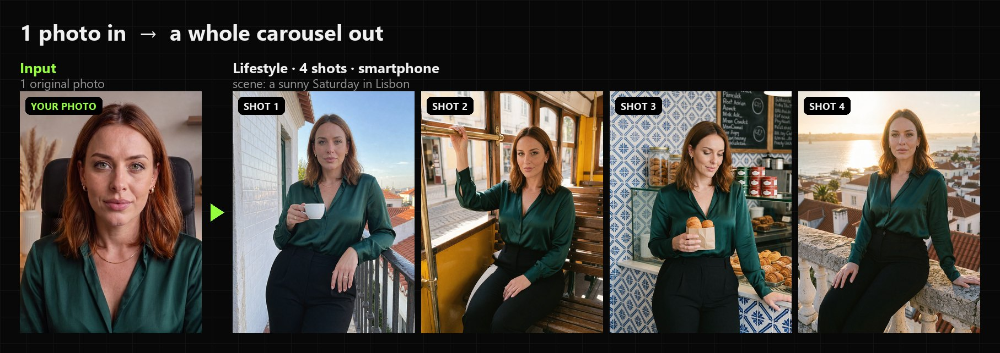
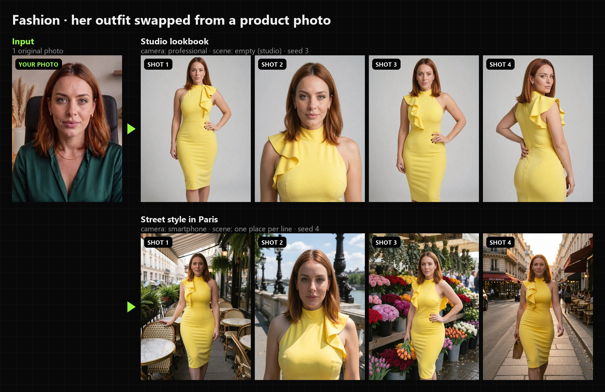
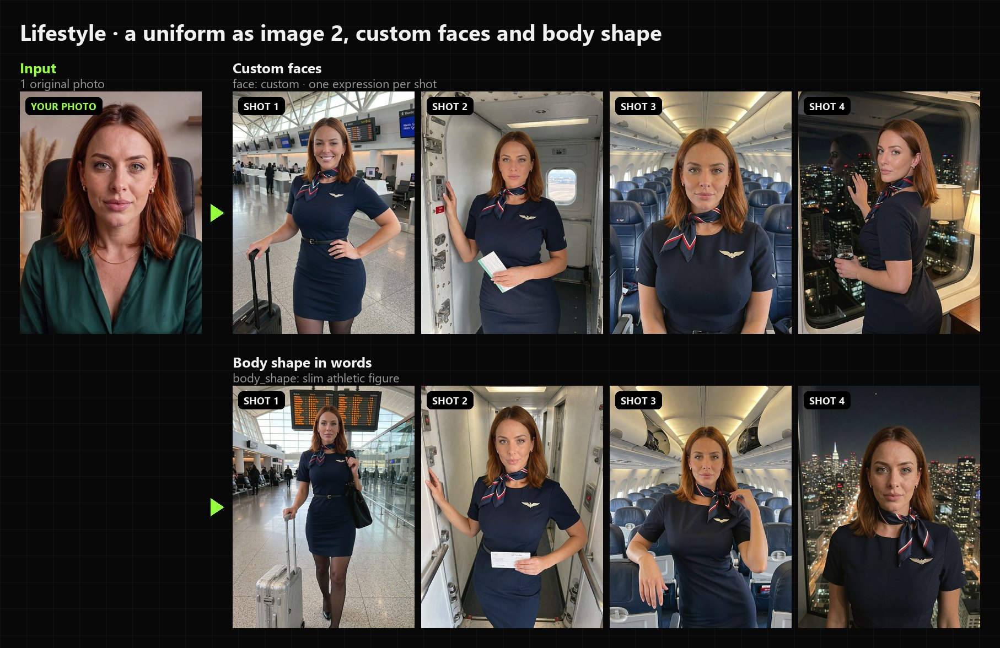
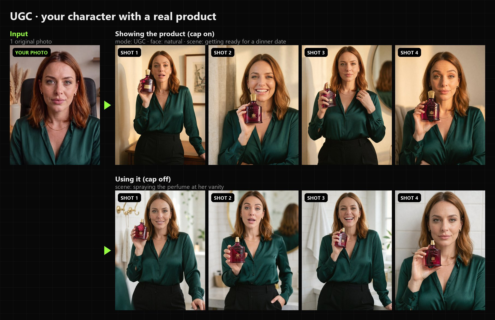
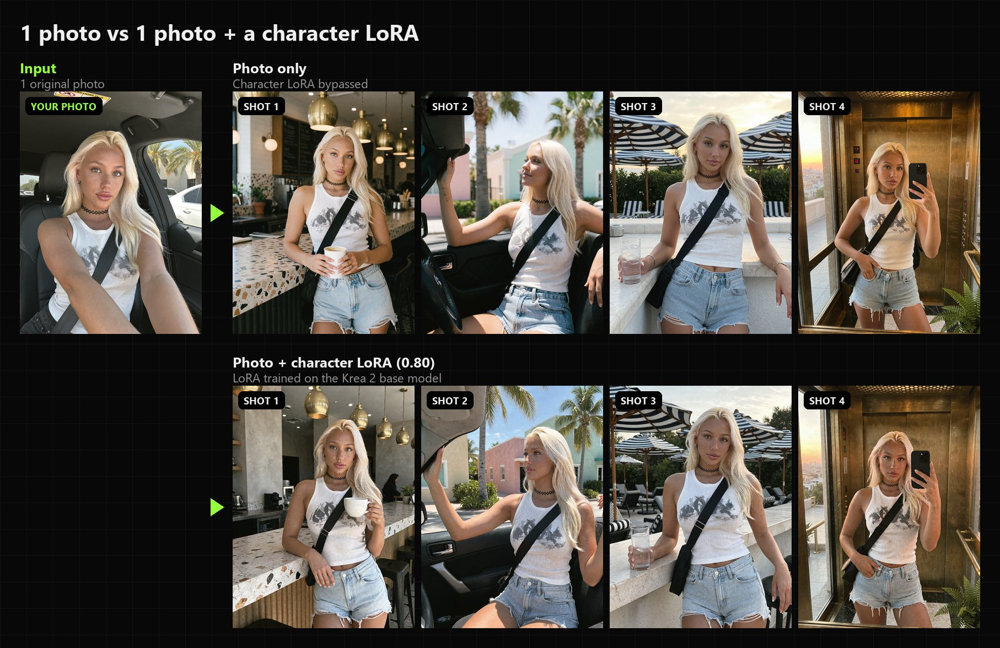

<div align="center">

# Krea 2 Edit Carousel for ComfyUI (PixelAI Labs)

### One photo of a person in. A whole carousel out.

2, 4 or 8 new photos of the **same person** in new places, poses, outfits, camera angles and expressions,
ready for an Instagram carousel, a fashion lookbook or a UGC product post. Runs locally in ComfyUI with **Krea 2** and the **Krea 2 Edit** LoRA (General Edit V2).

[](https://pixelailabs.com)
[](https://ko-fi.com/pixelailabs)



</div>

---

## Examples

Every set below comes from **one original photo** and one press of Run. No LoRA training, no masks, no prompt writing.

**Fashion lookbook:** the outfit comes from a product photo, then studio shots or street style in Paris.


**Lifestyle with a uniform:** custom expressions per shot, and a body shape written in words.


**UGC product photos:** your character holding, showing and using a real product.


**Optional character LoRA:** one photo already keeps the face; a LoRA trained on Krea 2 base locks it in at 100%.


---

## What it solves

| You are | The problem | What the Carousel does |
|---|---|---|
| **An AI influencer creator** | Your character looks different in every image, and a carousel needs 4 to 10 photos that clearly show the same person | Plans a full set (a day story, a trip, a night out) and keeps her face, hair and outfit across every shot |
| **A UGC creator / agency** | Brands want "real" creator photos with their product, fast | UGC mode plans the classic creator shots: product beside her face, close to the lens, in use, close-up under her chin |
| **An e-commerce store** | Model photoshoots for every new garment are expensive | Fashion mode puts any garment (ghost mannequin, flat lay or a model photo) on your model: studio front, close-up, three-quarter and back, or street style |

How it works: a vision AI reads your photo (and image 2), plans each shot like a photographer (place, pose, framing,
light, expression, camera), and writes one Krea 2 Edit prompt per shot. The workflow then renders every shot from your
original photo, so the identity never drifts from copy to copy.

---

## Installation

### 1. Install the node

**ComfyUI Manager:** *Custom Nodes Manager* → search **Krea2 Edit Carousel** → Install → restart ComfyUI.
(Or *Install via Git URL* and paste `https://github.com/Pixelailabs/ComfyUI-Krea2-Edit-Carousel`.)

**Manual:**

```bash
cd ComfyUI/custom_nodes
git clone https://github.com/Pixelailabs/ComfyUI-Krea2-Edit-Carousel
```

Restart ComfyUI. No extra Python packages are needed.

### 2. Install the node packs the workflow uses

| Node pack | Used for |
|---|---|
| [comfyui-krea2edit](https://github.com/lbouaraba/comfyui-krea2edit) | **Required.** The Krea 2 edit patch and grounded encode the Carousel Krea Edit node is built on |
| [ComfyUI-Easy-Use](https://github.com/yolain/ComfyUI-Easy-Use) | Background remover for image 2 (stops the old background from blending into the new scene) |
| [ComfyUI-FameGridColorFinish](https://github.com/Elevenheights/ComfyUI-FameGridColorFinish) | The final colour finish |
| [rgthree-comfy](https://github.com/rgthree/rgthree-comfy) | Labels in the workflow |

With ComfyUI Manager: open the workflow, then *Install Missing Custom Nodes*.

### 3. Download the models

| Model | Folder | Low VRAM? |
|---|---|---|
| `krea2_turbo_fp8_scaled.safetensors` (Krea 2 Turbo) | `models/diffusion_models` | use the **int8 convrot** version instead of fp8 |
| `qwen3vl_4b_fp8_scaled.safetensors` (Krea 2 text encoder) | `models/text_encoders` | use the **int8 convrot** version instead of fp8 |
| `qwen_image_vae.safetensors` | `models/vae` | |
| `krea2_general_edit_v2.safetensors` (Krea 2 General Edit V2) | `models/loras` | |
| `famegrid_spicy.safetensors` (FameGrid) | `models/loras` | optional style LoRA |
| `realism_engine_krea2_v3.1.safetensors` (Realism Engine) | `models/loras` | optional style LoRA |

The style LoRAs are on [civitai.com](https://civitai.com). All download links are in the description of the tutorial
video and on [pixelailabs.com](https://pixelailabs.com).

### 4. Choose who plans the shots

The Carousel Director needs a vision AI to read the photos and write the plan. Pick one in **Carousel Options → vision_llm**:

- **DeepSeek API** (default, best plans, really cheap). Get a key at
  [platform.deepseek.com](https://platform.deepseek.com), then copy `.env.example` to `.env` in this folder and paste it:
  ```
  DEEPSEEK_API_KEY=sk-...
  ```
  (An environment variable `DEEPSEEK_API_KEY` works too.)
- **A local Qwen3-VL**, fully offline: pick a Qwen3-VL text encoder from the list, for example the
  `qwen3vl_4b_fp8_scaled.safetensors` Krea 2 already uses. It's loaded for the plan only and freed right after, so it
  saves VRAM, but writing the plan takes longer. You can also plug the workflow's own CLIP into the Options' `clip` input.

### 5. Load the workflow

The workflow is in [`example_workflows/Krea2_Carousel.json`](example_workflows/Krea2_Carousel.json). Drag it into
ComfyUI, or find it in *Workflow → Browse Templates* under **ComfyUI-Krea2-Edit-Carousel**.

---

## Quick start (2 minutes)

1. In group **1 · PHOTO**, load the **original** photo of your person.
2. On the **Carousel Director**, leave the defaults: mode **Lifestyle**, **4** shots, camera **smartphone**, face **auto**.
3. Press **Run**.

You get 4 photos of her day (a café, a boutique, a car, a rooftop...) in `ComfyUI/output/carousel/`, plus one sheet
with all of them and the plan with every shot's prompt. Everything below is for when you want more control.

---

## The workflow at a glance

| Group | What it is | Do you touch it? |
|---|---|---|
| **1 · PHOTO** | The original photo of the person | Yes, always |
| **2 · IMAGE 2** | An outfit, a product, a second person or a body shape | Only when you need it (bypassed by default) |
| **3 · SETTINGS** | Carousel Director, size, Options | Yes |
| **4 · RESULT** | Every shot, one sheet, and the plan | Just look |
| **5 · Krea 2 turbo & LoRAs** | Models, style LoRAs, the bypassed Character LoRA | Once, to pick your models |
| **6 · ENGINE** | General Edit V2 sampling (10 steps) | No |

**To turn image 2 on:** click its node and press **Ctrl + B** (or right-click the group → *Set Group Nodes to Always*).
Press Ctrl + B again to bypass it.

**Size:** 1 MP for quick tests (about 25 s per shot), 2 MP for finals (about 45 s per shot).

---

## The nodes

### Carousel Director (PixelAI Labs)
The brain. Reads your photo (and image 2) with the vision AI, plans the set for the chosen mode, and writes one Krea 2
prompt per shot. Its `prompts` output is a **list**, so everything after it runs once per shot automatically.
Plans are cached on disk, so the same settings never pay for the same plan twice.

| Input | What it does | Choices / example |
|---|---|---|
| **photo** | The ORIGINAL photo of the person | Never a generated image: quality drops every time |
| **mode** | What kind of set | **Lifestyle**: her day in real places · **Fashion**: a lookbook of an outfit · **UGC**: her with a product |
| **shots** | How many photos | 2 · 4 · 8 |
| **camera** | The photo look | **smartphone**: a real iPhone photo · **professional**: pro camera, blurred background · **cinematic**: film still, moody light · **clean**: keeps your photo's own look · **auto**: smartphone for Lifestyle, professional for Fashion and UGC |
| **face** | Her expressions | **auto**: a different subtle expression each shot · **natural**: relaxed and real, best for UGC · **custom**: you write them |
| **custom_faces** | Your expressions (face = custom) | One line = same for every shot. One line per shot = in order: `slight smirk` / `wink` / `soft smile` |
| **scene** | Where it happens (optional) | Empty = chosen from the photo. One line = a vibe: `a sunny Saturday in Lisbon`. Several lines = one exact place per shot |
| **bottoms** | What she wears below the waist when the photo doesn't show it (optional) | `light-wash straight-leg jeans`. Empty = picked once and kept in every shot |
| **body_shape** | Her figure in words (optional) | `curvy hourglass figure` · `slim athletic figure` · `petite`. Empty = her own |
| **image_2_is** | What image 2 is | **outfit**: she wears it · **product**: she holds or uses it · **person**: they're in the shot with her · **body shape**: only the figure is taken |
| **seed** | A new plan from the same photo | 1, 2, 3... |
| **image_2** *(optional)* | The outfit, product or person | |
| **options** *(optional)* | Carousel Options | |

| Output | |
|---|---|
| **prompts** | One prompt per shot (a list) |
| **plan** | The story and every shot's prompt, readable |
| **setup** | What the Krea Edit node needs to wire image 2 the right way |
| **count** | Number of shots |

### Carousel Options (PixelAI Labs)
Advanced settings, plugged into the Director's `options` input. You can leave it as it is.

| Input | What it does |
|---|---|
| **story** | Lifestyle only: the order of the day (morning to night, a night out...) |
| **creativity** | How bold the places and camera angles are. 0.6 calm, 0.9 default, 1.2 wild |
| **image_2_name** | What image 2 is, e.g. `Creed Carmina perfume, cap off, gold spray nozzle`. The more precise, the better. Empty = read from the image |
| **face_detail_line** | Adds a line describing her face. Turn it on if a face drifts |
| **body_image_to_krea** | Body shape only: also gives the body image to Krea. A little stronger, but its clothes can leak. Off by default |
| **vision_llm** | Who plans the shots: DeepSeek API, or a local Qwen3-VL text encoder |
| **clip** *(optional)* | A Qwen3-VL CLIP the workflow already loads, used instead of vision_llm (no second load) |

### Carousel Krea Edit (PixelAI Labs)
Builds the Krea 2 edit conditioning for each shot from your original photo, with the right wiring for image 2 (outfit,
product and person are each wired differently, all tested). Needs **comfyui-krea2edit**.

Inputs: `model` (Krea 2 + General Edit V2 LoRA), `clip` (Krea 2 text encoder), `vae`, `image` (the same original
photo), `prompt` (from the Director), `setup`, `latent`, optional `image_2` and `grounding_px` (768).
Outputs: `model`, `positive`, `negative` for the sampler.

### Carousel Sheet (PixelAI Labs)
All shots on one image, `columns` per row (4 by default). Handy for a quick look or a client preview.


---

## Choosing good images

**The person (photo 1)**
- A clear face, normal light, a simple pose. The whole outfit visible if you want to keep it.
- Always the ORIGINAL photo, never a picture this workflow made (quality drops each time).
- Props in the photo (a microphone, a hand in the hair, crossed arms) tend to come back now and then. A clean photo
  gives clean shots.

**An outfit (image 2)**
- Best: a ghost-mannequin or flat-lay photo of the garment.
- A photo of a model wearing it works too: the node keeps your person's face and hair.
- For back shots, use an image that shows the back too (front + back side by side is fine).

**A product (image 2)**: a sharp photo on a plain white background, front facing the camera. Then write its name in
**Options → image_2_name**.

**A person (image 2)**: a clear photo of their face. Their background is removed automatically.

---

## Tips and known limits

- **Prep before you post:** run at 1 MP to find a seed you like, then switch to 2 MP for the final set.
- **Subtle expressions work best.** Big laughs and lip bites tend to look fake in custom faces.
- **Small products drift.** When the bottle is small in the frame, fine details (logo, text) can change. Products look
  best big, sharp and close to the lens.
- Waist-up shots sometimes come out a little wider than asked.
- UGC shots pick places that fit the product (a bathroom for skincare). Use **scene** to choose others.
- A face can drift in 1 shot out of 8: run again with another seed, turn on **face_detail_line**, or use a character LoRA.

---

## Learn more and support

<table>
<tr>
<td width="50%" valign="top">

### 🎓 Premium ComfyUI courses
Build AI influencers, UGC ads and AI video workflows from zero, including how to train a Krea 2 character LoRA for
100% identity: the **Ultimate AI Influencer Pro** course and more on **[pixelailabs.com](https://pixelailabs.com)**.

</td>
<td width="50%" valign="top">

### ☕ Support this project
This node is free. If it saves you a photoshoot, you can buy me a coffee:

<a href="https://ko-fi.com/pixelailabs"></a>

</td>
</tr>
</table>

---

## Credits

- [comfyui-krea2edit](https://github.com/lbouaraba/comfyui-krea2edit) and the Krea 2 Edit LoRAs, by lbouaraba
- [Krea 2](https://www.krea.ai) by Krea
- [ComfyUI-FameGridColorFinish](https://github.com/Elevenheights/ComfyUI-FameGridColorFinish),
  [ComfyUI-Easy-Use](https://github.com/yolain/ComfyUI-Easy-Use), [rgthree-comfy](https://github.com/rgthree/rgthree-comfy)

Made by **[PixelAI Labs](https://pixelailabs.com)**.
